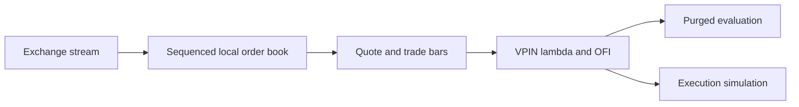

<p align="center"></p>

<h1 align="center">Toxicflow</h1>

<p align="center">
  <a href="https://github.com/FaiyazEnayet/toxicflow/actions/workflows/ci.yml"></a>
  
  
  
</p>

<p align="center">
  <a href="https://faiyazenayet.github.io/toxicflow/docs/dashboard.html"></a>
  <a href="#method"></a>
  <a href="#run-locally"></a>
</p>

Toxicflow records exchange order flow, reconstructs market state and tests whether liquidity signals carry useful short-horizon information. The dashboard keeps weak results visible rather than turning diagnostics into trading claims.


<p align="center"><a href="https://faiyazenayet.github.io/toxicflow/docs/dashboard.html"></a></p>


The important question is whether a toxicity signal arrives early enough to change an execution decision. Price, order flow and VPIN should therefore be read on the same clock, alongside calibration and baseline comparisons. The recorded experiment remains visible even where predictive performance offers little advantage over a simple reference model.

## Explore

- Inspect market price and VPIN with aligned timestamps and cross-chart readouts.
- Compare flow, impact and calibration without hiding the majority-class baseline.
- Review market-making outcomes under the same recorded session.

## Method

A synchronized local order book feeds VPIN, rolling Kyle lambda and order-flow imbalance. Return-direction models use purged walk-forward evaluation. A deliberately simplified market-making simulation illustrates the limits of toxicity gating. A separate analysis measures how the mid-price response associated with order-flow imbalance unfolds over time, from the shock bar itself out to five minutes.

## Evidence at a glance

| Scope | Recorded result or contract |
| :--- | :--- |
| Recorded session | 28,224 trades; 106,735 quotes; about 3.25 hours |
| Direction-model accuracy | 0.791 versus a 0.786 training-majority baseline on gap-censored rows (walk-forward export; 123 of 1,167 rows censored for touching the session's 920.1 s outage) |
| Toy market-making PnL | Open -14.51; toxicity-gated -3.58 |
| Price response to a 1 SD OFI shock | +0.10 bps in the shock bar, +0.22 bps at 60 s, +0.14 bps at 300 s (main session, inclusive baseline); the adjustment fit is not reported on any of the 6 recorded sessions, so no adjustment time constant is reported |
| Conclusion | No demonstrated predictive or trading edge in this session |

## Updating this project

Dashboard source language: **Rust and Python**. Generator: `scripts/dashboard.py`. The local interactive output is `docs/dashboard.html`.

## Run locally


```sh
cargo build --release
cargo test
./target/release/toxicflow export data/new --out runs/dashboard_data
python scripts/dashboard.py --data runs/dashboard_data --out docs/dashboard.html
```

## Technical design

The Rust recorder maintains exchange sequence discipline and writes quote/trade sessions to Parquet. VPIN uses equal-volume buckets; Kyle lambda estimates price impact from signed flow; OFI aggregates changes at the best bid and ask. The analysis and export commands share the metric functions used by the dashboard.



## Evaluation protocol

The predictor uses a purged walk-forward protocol, so future labels do not overlap the training window. Accuracy is compared with the majority-class rule and supplemented with calibration. The market-making example is intentionally simplified and cannot be interpreted as a deployable execution strategy.


The recorded session contains no demonstrated predictive edge over the baseline. Toxicity gating also does not improve the toy PnL. Those results make the evaluation and diagnostic tooling the contribution, rather than an unsupported trading-profit claim.

## OFI-price response

Kyle's lambda and OFI measure how much prices move with order flow. This analysis measures how the move unfolds over time. The estimand is observational throughout: order flow and prices are measured from the same quote stream, and the recorded sessions carry no news timestamps, so nothing here identifies a news event or a causal effect. Across six recorded Binance BTCUSDT sessions, one-second order-flow imbalance was positively associated with contemporaneous midprice changes, but the subsequent response paths varied across sessions and did not support a reliably identifiable price-adjustment half-life over the measured 0-300-second horizons.

On one-second bars, local projections regress the cumulative mid-price return to each horizon (0 to 300 seconds) on that bar's OFI, standardized by its session standard deviation. Two timing conventions are reported for every session. The inclusive response uses the close of the bar before the shock bar as its baseline, so its 0-second reading is the move inside the shock bar itself. The strictly post-bar response uses the shock bar's own close as its baseline, so its 0-second reading is zero by construction and its later readings measure only what happens after the shock bar closes. Origins whose window touches a bar with no observed quote are censored, so no response window crosses a feed outage. The same projections are also run on OFI innovations, the residuals from regressing OFI on its own previous 10 bars: the raw curve is the total association, including any follow-on flow the originating bar predicts, and the innovation curve conditions that predictable part out. The two are different estimands and are reported side by side, never merged. Shock diagnostics travel with them: OFI autocorrelation (lag-1 values run from 0.08 to 0.24 across the six sessions) and pre-shock regressions (in the main session, the previous three bars of returns explain R^2 = 0.002 of the shock, and the pre-shock bar's return correlates 0.02 with it).

Uncertainty comes from a segment-respecting block bootstrap: each session is split into its contiguous fully-observed segments, blocks are drawn only within a segment, and splice points are marked so no resampled window joins bars across a splice, an unobserved stretch, or the session boundary. The headline block length is 300 seconds; the report also tabulates 150, 600 and 900-second blocks wherever a session's segments permit them (the 30-minute captures support only 150 and 300 seconds), and the table is published in full rather than picked from. In the main session the 300-second interval width runs from 0.37 bps at 150-second blocks to 0.11 bps at 900-second blocks, narrowing as longer blocks splice less often and fewer windows are censored inside each resample. Simultaneous confidence bands across horizons and prespecified contrasts (R(60) - R(0) and R(300) - R(60), recomputed inside every resample) sit alongside the pointwise intervals, and a horizon-aware HAC standard error is reported next to the bootstrap: in the main session the 300-second interval is [-0.03, +0.20] bps by bootstrap and [-0.004, +0.279] bps by HAC. Response-share ratios are reported only when the denominator's interval excludes zero; in five of the six sessions the 300-second interval includes zero, so the shares are suppressed there with the reason recorded, and only the 2026-11-02 capture reports them. Each session also reports its effective number of non-overlapping 300-second blocks (30 in the main session, 5 in each 30-minute capture), which is the honest scale of the long-horizon sample next to the bar counts. The full curves and intervals are in `docs/info_speed_report.json` (schema `toxicflow.info-speed/v2`; the v1 fields keep their meanings and the inclusive point estimates are unchanged), produced by `examples/info_speed.rs`, and the same estimator runs inside `analyze` and `export` (as `speed.csv`, with its original columns, plus a `speed` block in `summary.json`).

| Session | Response at 0 s | Response at 60 s | Response at 300 s | Best adjustment-fit R^2 |
| :--- | ---: | ---: | ---: | ---: |
| Main session (3.25 h, 2026-10-10) | +0.10 bps | +0.22 bps | +0.14 bps | 0.75 |
| Capture 2026-10-30 (30 min) | +0.73 bps | +1.31 bps | +0.49 bps | 0.14 |
| Capture 2026-11-01 (30 min) | +0.07 bps | +0.19 bps | +0.08 bps | 0.37 |
| Capture 2026-11-02 (30 min) | +0.24 bps | +0.41 bps | +0.59 bps | 0.35 |
| Capture 2026-11-04 (30 min) | +0.26 bps | +0.98 bps | +1.33 bps | 0.95 |
| Capture 2026-11-06 (30 min) | +1.14 bps | +2.62 bps | +3.75 bps | -0.41 |

The responses in this table use the inclusive baseline. On the post-bar baseline the main session reads 0.00 bps at 0 seconds by construction, +0.13 bps at 60 seconds and +0.04 bps at 300 seconds, and the innovation projections in the main session read +0.10 bps at 0 seconds and +0.13 bps at 300 seconds, close to the raw curve there because that session's OFI autocorrelation is low.

The adjustment fit now carries a separately identified instantaneous term, R(h) = J + R_inf (1 - exp(-h / tau)), so the curve is no longer forced through zero at h = 0 even though every session's measured 0-second response is positive. The headline fit is weighted by the bootstrap covariance of the response vector, the fit is re-run inside every bootstrap draw, and the report publishes the profile loss over tau, the joint parameter region from those within-draw fits, and the fit's outcome across a table of R^2 thresholds and interior-margin choices instead of a single binary verdict. The honest result is still no reported time constant, stated plainly: five sessions fail the point-estimate gates, and the sixth (2026-11-04, R^2 = 0.95, at most 42% of any session's resamples producing a passing fit) passes those gates but its joint parameter region is not bounded, with within-draw taus running out to the edge of the 0.25-1500 second search grid, so no tau and no adjustment half-life is reported for any session and the empirical curves stand on their own. On the main session the ladder was also extended, to 1500 seconds (1,486 usable origins at the longest rung; the 1800-second rung is not supported, because no fully-observed segment in that session is long enough to hold a clean window for it), and the extended fit is not reported either (R^2 = 0.21). What the curves themselves show does not reduce to one pattern: from 60 to 300 seconds the response decreases in three sessions (main session -0.09 bps, 2026-10-30 -0.82 bps, 2026-11-01 -0.12 bps) and increases in three (2026-11-02 +0.18 bps, 2026-11-04 +0.35 bps, 2026-11-06 +1.14 bps). In the main session the 60-second contrast is +0.13 bps (bootstrap interval +0.05 to +0.15) and the 300-second reading (+0.14 bps) is statistically indistinguishable from the earlier ones. Per-session dispersion is wide: the 300-second response runs from +0.08 to +3.75 bps across the six sessions, so a single pooled number would hide more than it says. These are single-venue BTCUSDT recordings, and the responses are associations between order flow and price changes, not measurements of how fast news reaches prices.

## Code and data

`src/orderbook.rs` is the local book. `booksync.rs` runs the shared transactional sync state machine behind the recorder and the live dashboard. `metrics.rs` contains the estimators. `predict.rs` handles walk-forward evaluation. `speed.rs` estimates the observational OFI-price response curves (raw and innovation), their segment-bootstrap inference, and the adjustment fit. `strategy.rs` is the toy simulation. Dashboard inputs are exported session files, not an invented dataset.


## Limitations

- The session is too short to support broad microstructure conclusions.
- The response analysis inherits that limit and adds its own: six sessions from one venue and one symbol, an observational estimand (order flow and prices from the same quote stream, no identified news), the main session's fully-observed segments topping out at 1,799 bars so horizons past 1500 seconds cannot be checked on it, and innovation projections that condition on past OFI only, not on the wider market state.
- VPIN depends on bucket-volume calibration and does not identify informed traders by itself.
- The fill model excludes queue position, latency and fees. Missing-quote gap handling also needs a regression test.

## License

[MIT](LICENSE). Third-party datasets, libraries and fonts retain their own terms.
