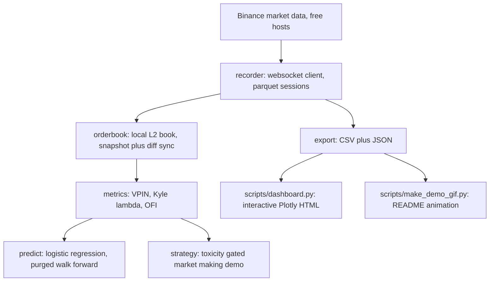

# toxicflow


**Order flow toxicity on free crypto data.** I wanted to know whether the microstructure ideas from the quant literature actually show up in markets I can touch for $0. So I built the full loop in Rust: stream Binance market data, maintain a local limit order book, compute toxicity metrics, and test whether order flow predicts short horizon returns.

Toxicity is the market maker's problem. When informed traders dominate the flow, anyone quoting passively gets picked off. They buy right before the price falls and sell right before it rises. Every metric here measures that adverse selection risk in real time.


Click this link to see: **[Live interactive demo](https://faiyazenayet.github.io/toxicflow/docs/dashboard.html)**. It shows VPIN over time, rolling Kyle's lambda, OFI versus forward returns, predictor calibration, and the market making demo. All from a real 3.25 hour BTCUSDT session. One self contained HTML file. It opens in any browser with no server.

## How the pieces fit



## Quickstart

```bash
cargo build --release
./target/release/toxicflow record --symbol BTCUSDT --minutes 15 --out data/btc
./target/release/toxicflow analyze data/btc
./target/release/toxicflow live --symbol BTCUSDT   # terminal dashboard
./target/release/toxicflow export data/btc --out runs/dashboard_data
python3 scripts/dashboard.py --data runs/dashboard_data --out docs/dashboard.html
```

Data comes from Binance's market data only hosts (`data-stream.binance.vision`). No API key needed. Sessions save to parquet: `trades.parquet`, `quotes.parquet`, `meta.json`.

## The three metrics

**VPIN.** Easley, Lopez de Prado, O'Hara. I group trades into equal volume buckets instead of time bars, so busy and quiet periods stay comparable. Each bucket scores |buy volume minus sell volume| / volume, and VPIN is the rolling mean over a window of buckets. High VPIN means one sided flow. Someone knows something. Trade direction comes from the exchange's own aggressor flag, so I never need the tick rule.

**Kyle's lambda.** The price impact coefficient. I take the rolling OLS slope of midprice changes on signed order flow over 10 second bars. High lambda means each unit of flow moves the price a lot. That is a thin book, and thin books are where market makers bleed.

**OFI.** Cont, Kukanov, Stoikov (2014). I build order flow imbalance from every quote change at the touch: bid size added when the bid ticks up, removed when it ticks down, mirrored on the ask side. Their result is that this quantity predicts the next midprice move. I test that claim directly.

## What a real session showed

I recorded about 3.25 hours of BTCUSDT in six 30 minute chunks: 28224 trades, 106735 quotes, 749.6 BTC of volume, price flat between 82932 and 83107. Real analyzer output on the merged session:

```
session: 28224 trades, 106735 quotes
span: 11724.4s, volume: 749.638 base units

VPIN: 50 equal-volume buckets
VPIN (50 buckets, window 20): mean 0.523, p90 0.671, max 0.716, last 0.504
Kyle lambda (10s bars, 60-bar window): mean 3.534752 price/vol, last 0.864679
OFI per 10s bar: mean +0.2045, std 10.6025

short-horizon prediction (10s bars, 30s horizon):
  accuracy 0.776 +- 0.417 vs baseline 0.809 (1167 bars, 4 folds)
  brier 0.1683
  calibration (pred -> realized):
    0.012 -> 0.161  (n=93)
    0.057 -> 0.043  (n=93)
    0.095 -> 0.054  (n=93)
    0.112 -> 0.032  (n=93)
    0.142 -> 0.075  (n=93)
    0.197 -> 0.161  (n=93)
    0.256 -> 0.237  (n=93)
    0.315 -> 0.280  (n=93)
    0.385 -> 0.548  (n=93)
    0.758 -> 0.323  (n=93)
    1.000 -> 0.000  (n=2)

market-making demo (toy fill model, NOT a strategy):
  pnl open -9.8684, pnl gated -10.1491 | gated 121/11727s (1%) | turnover 990264.5
```

Here is what I take from it. The bucket lesson from the earlier 12 minute session is confirmed. With 3.25 hours of data, 50 buckets gives about 15 BTC per bucket, which is well sized, and VPIN behaves: mean 0.523, max 0.716, against a buy share of 0.442 and a price that went nowhere. Rerunning with explicit 15 BTC buckets gives mean 0.521, essentially identical. Calibrate the bucket volume to the session and never compare raw VPIN levels to literature values computed on daily buckets. The `--bucket-btc` flag exists for exactly this.

Kyle's lambda of about 3.5 means each BTC of signed flow moved the mid by roughly $3.50 on 10 second bars. Plausible for BTC.

The predictor found no edge: 0.776 accuracy against a 0.809 majority class baseline, on 1167 bars. That is 18 times the data of the earlier session and the honest result is the same. The evaluation framework is the deliverable here: purged walk forward splits, no shuffling, calibration tables. It will tell you just as clearly when there is no edge as when there is one.

The market making demo is a toy and this session shows its missing piece. Both legs lost money: open -9.87, gated -10.15. Flow was net selling for three hours (buy share 0.442) into a flat market, and the toy has no inventory control, so it accumulated a long position and ate the spread on every unit. The gate stood down only 1% of the time because VPIN stayed below 0.7 almost everywhere, so the two legs are nearly identical. Compare with the 12 minute session where an over sensitive gate stood down 70% of the time. The demo makes the mechanism visible in both directions, and the real lesson is inventory management, which the toy deliberately omits.

## Module tour

- `src/orderbook.rs`: local L2 book with the exchange's snapshot plus diff sync procedure, gap detection, resync.
- `src/recorder.rs`: tokio websocket client, reconnect with backoff, parquet sessions.
- `src/metrics.rs`: VPIN, Kyle's lambda, OFI. Pure functions, unit tested on synthetic flow.
- `src/predict.rs`: hand rolled logistic regression, walk forward evaluation with a purge gap. Time series are never shuffled.
- `src/strategy.rs`: toxicity gated market making demo. Toy fill model, clearly labeled. It exists to show the direction of the effect, not to trade.
- `src/net.rs`: the sandbox I built this in has no direct internet, so websocket connections tunnel through the egress proxy via CONNECT. You will not need this on a normal machine, but it is harmless there.
- `src/main.rs`: CLI with `record`, `analyze`, `live`, and `export`. The export subcommand writes `vpin.csv`, `kyle.csv`, `ofi.csv`, `calibration.csv`, and `summary.json` for the dashboard, using the same metric functions as `analyze`.
- `scripts/dashboard.py`: builds `docs/dashboard.html` from the export output. Single self contained file, plotly.js embedded.
- `scripts/make_demo_gif.py`: renders `docs/demo.gif` from the same export output. Every frame is real session data.

## Regenerating the dashboard and the GIF

Both artifacts are generated, never hand made. To rebuild them from a new session:

```bash
./target/release/toxicflow record --symbol BTCUSDT --minutes 60 --out data/new
./target/release/toxicflow export data/new --out runs/dashboard_data
python3 scripts/dashboard.py --data runs/dashboard_data --out docs/dashboard.html
python3 scripts/make_demo_gif.py --data runs/dashboard_data --out docs/demo.gif
```

`scripts/dashboard.py` takes `--data` and `--out`. `scripts/make_demo_gif.py` takes the same, plus `--frames`.

## Honest limitations

- 3.25 hours of BTC is a session, not a study. Microstructure results need days of data across regimes.
- Crypto is not equities. No open or close auction, funding rates, 24/7 retail flow. Take any comparison to the equity literature with salt.
- VPIN itself is debated. It flagged the 2010 flash crash in hindsight and plenty of papers argue it is mostly repackaged volume. My session above is a live demonstration of why calibration matters.
- The market making demo has a toy fill model: no queue position, no latency, no fees. It demonstrates adverse selection, not a strategy.
- This is research code, not trading advice. Nothing here should touch real money.

## References

Easley, Lopez de Prado, O'Hara, "Flow Toxicity and Liquidity in a High Frequency World" (2012). Cont, Kukanov, Stoikov, "The Price Impact of Order Book Events" (2014). Kyle, "Continuous Auctions and Insider Trading" (1985).
