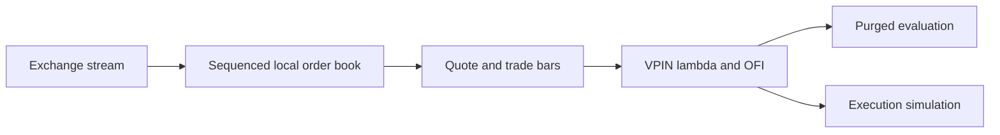

<p align="center"></p>

<h1 align="center">Toxicflow</h1>

<p align="center">
  <a href="https://github.com/FaiyazEnayet/toxicflow/actions/workflows/ci.yml"></a>
  
  
  
</p>

<p align="center">
  <a href="https://faiyazenayet.github.io/toxicflow/docs/dashboard.html"></a>
  <a href="#method"></a>
  <a href="#run-locally"></a>
</p>

Toxicflow records exchange order flow, reconstructs market state and tests whether liquidity signals carry useful short-horizon information. The dashboard keeps weak results visible rather than turning diagnostics into trading claims.


<p align="center"><a href="https://faiyazenayet.github.io/toxicflow/docs/dashboard.html"></a></p>


The important question is whether a toxicity signal arrives early enough to change an execution decision. Price, order flow and VPIN should therefore be read on the same clock, alongside calibration and baseline comparisons. The recorded experiment remains visible even where predictive performance offers little advantage over a simple reference model.

## Explore

- Inspect market price and VPIN with aligned timestamps and cross-chart readouts.
- Compare flow, impact and calibration without hiding the majority-class baseline.
- Review market-making outcomes under the same recorded session.

## Method

A synchronized local order book feeds VPIN, rolling Kyle lambda and order-flow imbalance. Return-direction models use purged walk-forward evaluation. A deliberately simplified market-making simulation illustrates the limits of toxicity gating. A separate analysis measures how the mid-price response to order-flow shocks unfolds over time, from the shock bar itself out to five minutes.

## Evidence at a glance

| Scope | Recorded result or contract |
| :--- | :--- |
| Recorded session | 28,224 trades; 106,735 quotes; about 3.25 hours |
| Direction-model accuracy | 0.791 versus a 0.786 training-majority baseline on gap-censored rows (walk-forward export; 123 of 1,167 rows censored for touching the session's 920.1 s outage) |
| Toy market-making PnL | Open -14.51; toxicity-gated -3.58 |
| Price response to a 1 SD OFI shock | +0.10 bps in the shock bar, +0.22 bps at 60 s, +0.14 bps at 300 s (main session); the exponential adjustment fit fails on all 6 recorded sessions, so no adjustment time constant is reported |
| Conclusion | No demonstrated predictive or trading edge in this session |

## Updating this project

Dashboard source language: **Rust and Python**. Generator: `scripts/dashboard.py`. The local interactive output is `docs/dashboard.html`.

## Run locally


```sh
cargo build --release
cargo test
./target/release/toxicflow export data/new --out runs/dashboard_data
python scripts/dashboard.py --data runs/dashboard_data --out docs/dashboard.html
```

## Technical design

The Rust recorder maintains exchange sequence discipline and writes quote/trade sessions to Parquet. VPIN uses equal-volume buckets; Kyle lambda estimates price impact from signed flow; OFI aggregates changes at the best bid and ask. The analysis and export commands share the metric functions used by the dashboard.



## Evaluation protocol

The predictor uses a purged walk-forward protocol, so future labels do not overlap the training window. Accuracy is compared with the majority-class rule and supplemented with calibration. The market-making example is intentionally simplified and cannot be interpreted as a deployable execution strategy.


The recorded session contains no demonstrated predictive edge over the baseline. Toxicity gating also does not improve the toy PnL. Those results make the evaluation and diagnostic tooling the contribution, rather than an unsupported trading-profit claim.

## Information incorporation speed

Kyle's lambda and OFI measure how much prices move with order flow. This analysis measures how the move unfolds over time. Order-flow shocks are the information-arrival proxy throughout: information is inferred from trades themselves, in the Hasbrouck sense, and the recorded sessions carry no news timestamps, so nothing here identifies a news event.

On one-second bars, local projections regress the cumulative mid-price return from just before a shock bar to each horizon (0 to 300 seconds) on that bar's OFI, standardized by its session standard deviation. Origins whose window touches a bar with no observed quote are censored, so no response window crosses the session's feed outage. An exponential adjustment curve, R(h) = R_inf (1 - exp(-h / tau)), is fit to the cumulative response and reported only when it actually fits (R^2 at or above 0.85, positive long-run response, tau interior to the search grid); intervals come from a moving-block bootstrap with the same conventions as the session pilot evaluation. The full curves and intervals are in `docs/info_speed_report.json`, produced by `examples/info_speed.rs`, and the same estimator runs inside `analyze` and `export` (as `speed.csv` plus a `speed` block in `summary.json`).

| Session | Response at 0 s | Response at 60 s | Response at 300 s | Best exponential R^2 |
| :--- | ---: | ---: | ---: | ---: |
| Main session (3.25 h, 2026-10-10) | +0.10 bps | +0.22 bps | +0.14 bps | 0.15 |
| Capture 2026-10-30 (30 min) | +0.73 bps | +1.31 bps | +0.49 bps | -0.52 |
| Capture 2026-11-01 (30 min) | +0.07 bps | +0.19 bps | +0.08 bps | 0.25 |
| Capture 2026-11-02 (30 min) | +0.24 bps | +0.41 bps | +0.59 bps | -0.09 |
| Capture 2026-11-04 (30 min) | +0.26 bps | +0.98 bps | +1.33 bps | 0.73 |
| Capture 2026-11-06 (30 min) | +1.14 bps | +2.62 bps | +3.75 bps | 0.38 |

The honest result is a failed fit, stated plainly: in no session does the cumulative response settle the way a single exponential adjustment path says it should. The best fit across the six sessions explains R^2 = 0.73 of its curve, below the 0.85 bar, and at most 1.5% of any session's bootstrap resamples produce a passing fit, so no tau and no adjustment half-life is reported for any session; the empirical curves stand on their own. What the curves do show is a fast start and a slow, unsettled tail: in the main session about half of the 60-second response (+0.10 of +0.22 bps) is already present in the shock bar itself, the response peaks around one minute, and the 300-second reading (+0.14 bps, bootstrap interval -0.09 to +0.27) is statistically indistinguishable from the earlier ones. Per-session dispersion is wide: the 300-second response runs from +0.08 to +3.75 bps across the six sessions, so a single pooled speed number would hide more than it says. These are single-venue BTCUSDT recordings, and OFI shocks proxy for information arrival rather than identifying it.

## Code and data

`src/orderbook.rs` is the local book. `booksync.rs` runs the shared transactional sync state machine behind the recorder and the live dashboard. `metrics.rs` contains the estimators. `predict.rs` handles walk-forward evaluation. `speed.rs` estimates the price-response curve and the adjustment fit. `strategy.rs` is the toy simulation. Dashboard inputs are exported session files, not an invented dataset.


## Limitations

- The session is too short to support broad microstructure conclusions.
- The speed analysis inherits that limit and adds its own: six sessions from one venue and one symbol, OFI shocks as an information proxy rather than identified news, and local projections that do not purge correlated later shocks from the response window.
- VPIN depends on bucket-volume calibration and does not identify informed traders by itself.
- The fill model excludes queue position, latency and fees. Missing-quote gap handling also needs a regression test.

## License

[MIT](LICENSE). Third-party datasets, libraries and fonts retain their own terms.
