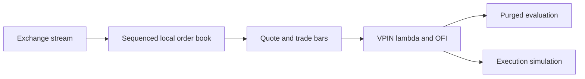
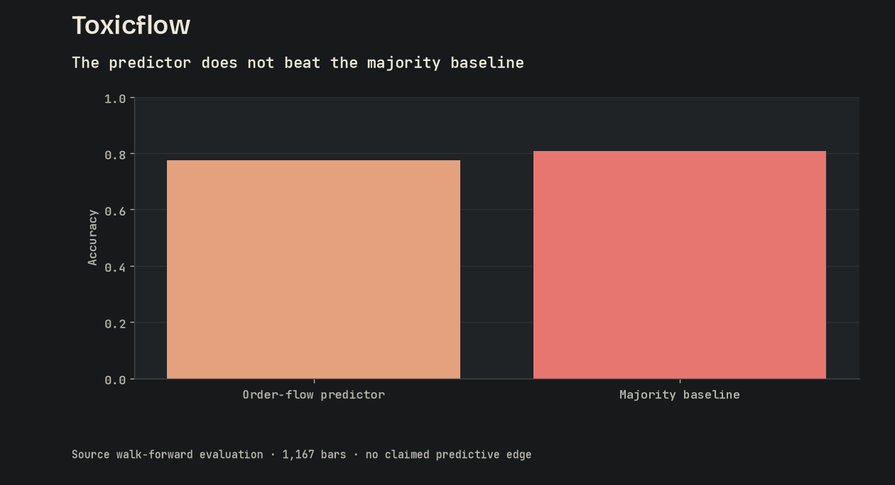

<p align="center"></p>

<h1 align="center">Toxicflow</h1>

<p align="center">
  <a href="https://github.com/FaiyazEnayet/toxicflow/actions/workflows/ci.yml"></a>
  
  
  
</p>

<p align="center">
  <a href="https://faiyazenayet.github.io/toxicflow/docs/dashboard.html"></a>
  <a href="#method"></a>
  <a href="#run-locally"></a>
</p>

Toxicflow records exchange order flow, reconstructs market state and tests whether liquidity signals carry useful short-horizon information. The dashboard keeps weak results visible rather than turning diagnostics into trading claims.


<p align="center"><a href="https://faiyazenayet.github.io/toxicflow/docs/dashboard.html"></a></p>


The important question is whether a toxicity signal arrives early enough to change an execution decision. Price, order flow and VPIN should therefore be read on the same clock, alongside calibration and baseline comparisons. The recorded experiment remains visible even where predictive performance offers little advantage over a simple reference model.

## Explore

- Inspect market price and VPIN with aligned timestamps and cross-chart readouts.
- Compare flow, impact and calibration without hiding the majority-class baseline.
- Review market-making outcomes under the same recorded session.

## Method

A synchronized local order book feeds VPIN, rolling Kyle lambda and order-flow imbalance. Return-direction models use purged walk-forward evaluation. A deliberately simplified market-making simulation illustrates the limits of toxicity gating.

## Evidence at a glance

| Scope | Recorded result or contract |
| :--- | :--- |
| Recorded session | 28,224 trades; 106,735 quotes; about 3.25 hours |
| Direction-model accuracy | 0.791 versus a 0.786 majority-class baseline on gap-censored rows (walk-forward export; 123 of 1,167 rows censored for touching the session's 920.1 s outage) |
| Toy market-making PnL | Open -11.34; toxicity-gated -0.84 |
| Conclusion | No demonstrated predictive or trading edge in this session |

## Updating this project

Dashboard source language: **Rust and Python**. Generator: `scripts/dashboard.py`. The local interactive output is `docs/dashboard.html`.

## Run locally


```sh
cargo build --release
cargo test
./target/release/toxicflow export data/new --out runs/dashboard_data
python scripts/dashboard.py --data runs/dashboard_data --out docs/dashboard.html
```

## Technical design

The Rust recorder maintains exchange sequence discipline and writes quote/trade sessions to Parquet. VPIN uses equal-volume buckets; Kyle lambda estimates price impact from signed flow; OFI aggregates changes at the best bid and ask. The analysis and export commands share the metric functions used by the dashboard.



## Evaluation protocol

The predictor uses a purged walk-forward protocol, so future labels do not overlap the training window. Accuracy is compared with the majority-class rule and supplemented with calibration. The market-making example is intentionally simplified and cannot be interpreted as a deployable execution strategy.



The recorded session contains no demonstrated predictive edge over the baseline. Toxicity gating also does not improve the toy PnL. Those results make the evaluation and diagnostic tooling the contribution, rather than an unsupported trading-profit claim.

## Code and data

`src/orderbook.rs` handles book synchronization. `metrics.rs` contains the estimators. `predict.rs` handles walk-forward evaluation. `strategy.rs` is the toy simulation. Dashboard inputs are exported session files, not an invented dataset.


## Limitations

- The session is too short to support broad microstructure conclusions.
- VPIN depends on bucket-volume calibration and does not identify informed traders by itself.
- The fill model excludes queue position, latency and fees. Missing-quote gap handling also needs a regression test.

## License

[MIT](LICENSE). Third-party datasets, libraries and fonts retain their own terms.
