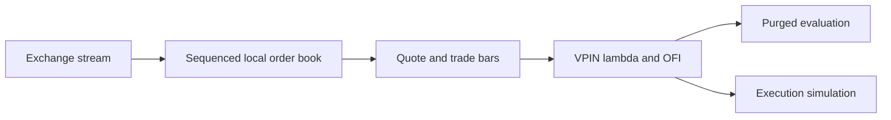
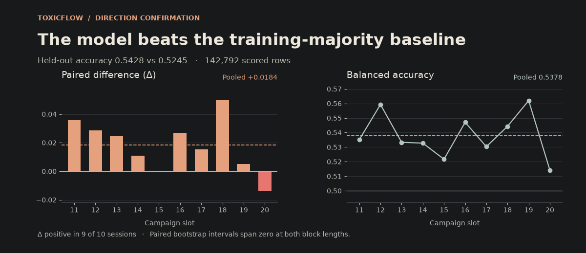

<p align="center"></p>

<h1 align="center">Toxicflow</h1>

<p align="center">
  <a href="https://github.com/FaiyazEnayet/toxicflow/actions/workflows/ci.yml"></a>
  
  
  
</p>

<p align="center">
  <a href="https://faiyazenayet.github.io/toxicflow/docs/dashboard.html"></a>
  <a href="#method"></a>
  <a href="#run-locally"></a>
</p>

Toxicflow records exchange order flow, reconstructs market state and tests whether liquidity signals carry useful short-horizon information, and traces how the mid-price responds to order-flow shocks over the seconds after they land. The dashboard presents every result against its baseline, so diagnostics and measured outcomes read side by side.


<p align="center"><a href="https://faiyazenayet.github.io/toxicflow/docs/dashboard.html"></a></p>


A toxicity signal earns its place when it arrives early enough to change an execution decision, so price, order flow and VPIN are read on the same clock, alongside calibration and baseline comparisons. The recorded experiment is reported in full, with predictive performance measured against its reference model on every session.

## Explore

- Inspect market price and VPIN with aligned timestamps and cross-chart readouts.
- Compare flow, impact and calibration against the majority-class baseline.
- Review market-making outcomes under the same recorded session.
- Trace how the mid-price response to an order-flow shock unfolds over the 300 seconds after it lands.

## Method

A synchronized local order book feeds VPIN, rolling Kyle lambda and order-flow imbalance. Return-direction models use purged walk-forward evaluation. A simplified market-making simulation measures what toxicity gating does to execution outcomes. A separate analysis measures how the mid-price response associated with order-flow imbalance unfolds over time, from the shock bar itself out to five minutes.

## Evidence at a glance

| Scope | Recorded result or contract |
| :--- | :--- |
| Recorded session | 28,224 trades; 106,735 quotes; about 3.25 hours |
| Direction-model accuracy | 0.791 versus a 0.786 training-majority baseline on gap-censored rows (walk-forward export; 123 of 1,167 rows censored for touching the session's 920.1 s outage) |
| Toy market-making PnL | Open -14.51; toxicity-gated -3.58 |
| Price response to a 1 SD OFI shock | +0.10 bps in the shock bar, +0.22 bps at 60 s, +0.14 bps at 300 s (main session, inclusive baseline); the empirical response curves are the reported result, and no adjustment time constant is claimed for any of the 6 recorded sessions |
| Conclusion | Results stand as measured in this session; the registered confirmation study below tests the direction question on a dedicated recording campaign |

## Updating this project

Dashboard source language: **Rust and Python**. Generator: `scripts/dashboard.py`. The local interactive output is `docs/dashboard.html`.

## Run locally


```sh
cargo build --release
cargo test
./target/release/toxicflow export data/new --out runs/dashboard_data
python scripts/dashboard.py --data runs/dashboard_data --out docs/dashboard.html
```

## Technical design

The Rust recorder maintains exchange sequence discipline and writes quote/trade sessions to Parquet. VPIN uses equal-volume buckets; Kyle lambda estimates price impact from signed flow; OFI aggregates changes at the best bid and ask. The analysis and export commands share the metric functions used by the dashboard.



## Evaluation protocol

The predictor uses a purged walk-forward protocol, so future labels do not overlap the training window. Accuracy is compared with the majority-class rule and supplemented with calibration. The market-making example is a simplified simulation scoped to the gating question.



The recorded session's predictor result sits close to the baseline, and toxicity gating does not improve the toy PnL. The session's contribution is the evaluation and diagnostic tooling itself: purged walk-forward scoring, calibration and response estimation, each reported with its full measurement record.

## Direction confirmation

The pilot's open question gets one prespecified test on the November 2026 recording campaign. The protocol is registered in `docs/direction_confirmation_protocol.md` before any campaign outcome is available to the predictor work: a 60-second target on one-second bars, four fixed feature families, one ridge fitting rule, development on the six archive sessions plus the first ten campaign slots, and a single confirmatory score on the last ten slots. Those ten are sealed in `src/direction_manifest.rs`, so fit-side code cannot resolve them, directly or through a derived key, and the confirmation step must present the protocol's registered digest. Win, partial, null and incomplete outcomes are all published under the registered wording.

## OFI-price response

Kyle's lambda and OFI measure how much prices move with order flow. This analysis measures how the move unfolds over time. The estimand is observational throughout: order flow and prices are measured from the same quote stream, and the recorded sessions carry no news timestamps, so nothing here identifies a news event or a causal effect. Across six recorded Binance BTCUSDT sessions, one-second order-flow imbalance was positively associated with contemporaneous midprice changes, and the subsequent response paths varied across sessions; over the measured 0-300-second horizons the curves themselves are the result, and no single price-adjustment half-life is identified.

On one-second bars, local projections regress the cumulative mid-price return to each horizon (0 to 300 seconds) on that bar's OFI, standardized by its session standard deviation. Two timing conventions are reported for every session. The inclusive response uses the close of the bar before the shock bar as its baseline, so its 0-second reading is the move inside the shock bar itself. The strictly post-bar response uses the shock bar's own close as its baseline, so its 0-second reading is zero by construction and its later readings measure only what happens after the shock bar closes. Origins whose window touches a bar with no observed quote are censored, so no response window crosses a feed outage. The same projections are also run on OFI innovations, the residuals from regressing OFI on its own previous 10 bars: the raw curve is the total association, including any follow-on flow the originating bar predicts, and the innovation curve conditions that predictable part out. The two are different estimands and are reported side by side, never merged. Shock diagnostics travel with them: OFI autocorrelation (lag-1 values run from 0.08 to 0.24 across the six sessions) and pre-shock regressions (in the main session, the previous three bars of returns explain R^2 = 0.002 of the shock, and the pre-shock bar's return correlates 0.02 with it).

Uncertainty comes from a segment-respecting block bootstrap: each session is split into its contiguous fully-observed segments, blocks are drawn only within a segment, and splice points are marked so no resampled window joins bars across a splice, an unobserved stretch, or the session boundary. Segment choice is two-stage and segment-fair: a segment is chosen with weight equal to the larger of its length and the drawn block length, then a uniform valid start inside it, and a segment shorter than the block is drawn whole, so every segment's expected share of the resampled bars equals its share of the observed bars. (The weighting is what makes the scheme segment-fair: pooling every valid start instead would leave segments shorter than the drawn block out of every resample and weight longer segments by their valid-start counts rather than by length, tilting the resamples toward the longest segments and narrowing the intervals on segmented sessions. The segment-fair scheme is the one whose percentile intervals hold their coverage on sessions with gaps in simulation, with the point estimates centred; on a single clean segment it draws exactly what pooled-start sampling draws, and the five captures' intervals are the same under either scheme.) The headline block length is 300 seconds; the report also tabulates 150, 600 and 900-second blocks wherever a session's segments permit them (the 30-minute captures support only 150 and 300 seconds), and the table is published in full rather than picked from. In the main session the 300-second interval width runs from 0.40 bps at 150-second blocks to 0.21 bps at 900-second blocks. Every ladder also reports the size of its block-start pool and how many distinct blocks its resamples actually drew; a ladder whose pool has fewer than 20 distinct starts is degenerate, and its intervals are suppressed with the reason recorded instead of being published as narrow intervals behind a full resample count. Simultaneous confidence bands across horizons and prespecified contrasts (R(60) - R(0) and R(300) - R(60), recomputed inside every resample) sit alongside the pointwise intervals, and a horizon-aware HAC standard error is reported next to the bootstrap: in the main session the 300-second interval is [-0.08, +0.18] bps by bootstrap and [-0.004, +0.279] bps by HAC. Response-share ratios are reported only when the denominator's interval excludes zero; in five of the six sessions the 300-second interval includes zero, so the shares are suppressed there with the reason recorded, and only the 2026-11-02 capture reports them. Each session also reports its effective number of non-overlapping 300-second blocks (30 in the main session, 5 in each 30-minute capture), which is the effective scale of the long-horizon sample next to the bar counts. The full curves and intervals are in `docs/info_speed_report.json` (schema `toxicflow.info-speed/v3`; the v1 and v2 fields keep their meanings and the inclusive point estimates are unchanged), produced by `examples/info_speed.rs`, and the same estimator runs inside `analyze` and `export` (as `speed.csv`, with its original columns, plus a `speed` block in `summary.json`).

| Session | Response at 0 s | Response at 60 s | Response at 300 s | Best adjustment-fit R^2 |
| :--- | ---: | ---: | ---: | ---: |
| Main session (3.25 h, 2026-10-10) | +0.10 bps | +0.22 bps | +0.14 bps | 0.75 |
| Capture 2026-10-30 (30 min) | +0.73 bps | +1.31 bps | +0.49 bps | 0.14 |
| Capture 2026-11-01 (30 min) | +0.07 bps | +0.19 bps | +0.08 bps | 0.37 |
| Capture 2026-11-02 (30 min) | +0.24 bps | +0.41 bps | +0.59 bps | 0.35 |
| Capture 2026-11-04 (30 min) | +0.26 bps | +0.98 bps | +1.33 bps | 0.95 |
| Capture 2026-11-06 (30 min) | +1.14 bps | +2.62 bps | +3.75 bps | -0.41 |

The responses in this table use the inclusive baseline. On the post-bar baseline the main session reads 0.00 bps at 0 seconds by construction, +0.13 bps at 60 seconds and +0.04 bps at 300 seconds, and the innovation projections in the main session read +0.10 bps at 0 seconds and +0.13 bps at 300 seconds, close to the raw curve there because that session's OFI autocorrelation is low.

The adjustment fit carries a separately identified instantaneous term, R(h) = J + R_inf (1 - exp(-h / tau)), so the curve is not forced through zero at h = 0 even though every session's measured 0-second response is positive. The headline fit is weighted by the bootstrap covariance of the response vector, the fit is re-run inside every bootstrap draw with that same weight matrix (held fixed across the draws, so the draw fits summarize the same estimator as the point fit), and the report publishes the profile loss over tau, the componentwise parameter intervals from those within-draw fits (each parameter's own percentile interval over the draw fits, not a joint region; a tau is promoted only when the tau interval sits strictly inside the search grid and spans less than a fourfold ratio), and the fit's outcome across a table of R^2 thresholds and interior-margin choices instead of a single binary verdict. The result is a response curve for every session and no reported time constant: five sessions do not clear the point-estimate gates, and the sixth (2026-11-04, R^2 = 0.95, at most 17% of any session's resamples producing a passing fit) clears those gates while its tau interval from the within-draw fits is not bounded (it spans a 47-fold range, far past the fourfold limit), so no tau and no adjustment half-life is reported for any session and the empirical curves stand on their own. The extended ladder enforces the same promotion contract as the headline fit: its tau is reported only when its point fit passes judging and its tau is bounded by the extended ladder's own within-draw fits. On the main session the ladder extends to 1500 seconds (1,486 usable origins at the longest rung; the 1800-second rung is not supported, because no fully-observed segment in that session is long enough to hold a clean window for it), and the extended fit is not reported. On this segmented session the extended resampling pool is degenerate (the drawn block is 1,799 bars, and the session's segments offer only a handful of distinct block starts, seven under the segment-fair counting), so resamples would be near-identical repeats and intervals at 900 and 1500 seconds come out 0.06 bps wide where the headline intervals are 0.10-0.50 bps wide. The report therefore publishes the extended ladder's start pool, and because that pool is below the stated minimum of 20 distinct starts its intervals are suppressed with the reason recorded; the extended point curve itself stands as published. What the curves themselves show does not reduce to one pattern: from 60 to 300 seconds the response decreases in three sessions (main session -0.09 bps, 2026-10-30 -0.82 bps, 2026-11-01 -0.12 bps) and increases in three (2026-11-02 +0.18 bps, 2026-11-04 +0.35 bps, 2026-11-06 +1.14 bps). In the main session the 60-second contrast is +0.13 bps (bootstrap interval +0.06 to +0.18) and the 300-second reading (+0.14 bps) is statistically indistinguishable from the earlier ones. Per-session dispersion is wide: the 300-second response runs from +0.08 to +3.75 bps across the six sessions, so a single pooled number would hide more than it says. These are single-venue BTCUSDT recordings, and the responses are associations between order flow and price changes, not measurements of how fast news reaches prices.

The same report carries a set of robustness variants under the same frozen protocol (same sessions, horizons, timing conventions and censoring rule), in a per-session `variants` block, with a pooled block at the top level. The gap audit settles a question the counts alone left open: the main session's 940 unobserved bars fall in six distinct stretches (2, 4, 5, 919, 6 and 4 bars), not one. The 919-bar stretch is the outage named elsewhere in this README: the 920.1-second gap between quotes spans 919 fully empty one-second bars, and the other 21 unobserved bars sit in five short stretches of two to six bars. Classified by the recorded quote age at each bar's end, 890 of the 940 bars are confirmed feed loss (newest quote over 30 seconds old), 44 are stale quotes (two to 30 seconds) and six are valid no-updates (under two seconds). Censoring at the 300-second horizon drops 2,746 of 11,426 potential origins in the main session (24.0%; at 0 seconds it is 946 of 11,726, or 8.1%), and it is not evenly spread: 40% of origins in the lowest trailing-activity quartile and 45% of origins whose own shock is zero are censored, against 16 to 22% elsewhere. Under an equal-variance approximation the censored origins would need an average response of -0.44 bps per SD, about 3.2 times the usable origins' +0.14 bps and of the opposite sign, to bring the pooled 300-second response to zero, so censoring alone would have to be strongly selective in a specific direction to change the sign of the headline reading. The five captures have no unobserved bars and no censoring at all.

Alternative price measures change very little, and the reason is in the data: the recorded spread sits at one tick for most bars, so the microprice is the midprice up to a fraction of the tick and its response curve differs from the mid curve by at most 0.0007 bps at any horizon in any session. The trade-price curve, built from the last trade in each bar, tracks the mid curve more loosely but still closely: at 300 seconds it reads +0.13 bps against the mid's +0.14 bps in the main session, and the largest gap at any horizon in any session is 0.08 bps. In raw OFI units the main session's response is 0.045 bps per unit of per-bar OFI at 300 seconds; across sessions the per-unit response at 300 seconds runs from 0.026 to 0.250 bps, a tenfold range, against the fiftyfold range of the per-SD readings (0.08 to 3.75 bps), so part of the cross-session dispersion is the standardisation, not the response itself.

The largest-OFI-burst study is prespecified: a burst is an origin bar at or above the session's 95th percentile of |OFI|, events are taken first-event-wins with a 300-bar refractory window so event windows never overlap, and a horizon reports only with at least ten clean event windows. In the main session 540 candidate bars shrink to 33 events, whose mean signed response is +0.24 bps in the burst bar, +0.63 bps at 60 seconds and +1.08 bps at 300 seconds (26 clean windows at the longest horizon). Each capture retains only six events, below the reporting minimum at every horizon, so no burst means are published for them. This is a conditional result scoped to extreme events; typical shocks are read from the headline curves. On the volume clock (equal-volume buckets of 0.064 BTC in the main session, horizons counted in buckets), the main session reads +0.02 bps at bucket 0, +0.17 bps at 60 buckets and +0.15 bps at 300 buckets: a separate volume-time estimand, not a seconds-based speed. The pooled block reports a precision-weighted mean response of +0.17, +0.27 and +0.18 bps at 0, 60 and 300 seconds and an equal-weight mean of +0.43, +0.96 and +1.06 bps, strictly as a description of these six sessions; no pooled tau or half-life is reported. Split by pre-shock activity terciles, the main session's 300-second response is +0.37 bps after quiet origins, +0.08 bps in the middle tercile and +0.14 bps after busy origins, so the pooled curve is not one regime's curve; the spread terciles are close to degenerate because the spread is one tick almost everywhere, and two middle spread strata in the captures fall below the reporting minimum and are suppressed with the reason recorded.

Resolution is checked two ways. The quote timestamps sit on a roughly 100 ms grid (median inter-quote gap 100 ms), a 500 ms bar grid is 92% observed in the main session and fully observed in the captures, and it supports the whole ladder: the main session's half-second response is +0.06 bps at 0 seconds and +0.11 bps at 300 seconds, against +0.10 and +0.14 bps on the one-second grid, because the finer grid splits the shock bar's move across two bars. 500 ms is the finest clock resolution the recordings fully support, and no finer seconds-based reading is claimed. On event-time bars of ten quote updates, the main session reads +0.10 bps at the first event bar, +0.22 bps at 60 event bars and +0.18 bps at 300 event bars, close to the clock-time shape, so the response shape is not an artefact of the one-second grid.

Two cross-checks sit in the same report, in a per-session `crosschecks` block. The first is a reduced-form VAR on the same one-second bars (price returns, OFI, and the spread and imbalance the bar builder already computes), estimated per session with the lag order chosen by BIC over orders 1 to 10: order 1 in all five captures, and order 3 in the main session, where the criterion is nearly flat between orders 1 and 3. Under an OFI-first Cholesky ordering, its cumulative response to a one-SD OFI shock tracks the projection curves closely in the first seconds of every session (within 0.07 bps at the 0-second rung) and at 300 seconds in the main session (+0.15 against +0.14 bps); counting a horizon as agreeing only when each estimate lies inside the other's band, the two agree on 7 of 16 rungs in the main session and on 2 to 7 rungs in the captures. Where they disagree is the long end of the sessions whose projection curves keep building: a low-order VAR settles geometrically, so at 300 seconds it reads +0.43 bps against the projections' +1.33 bps in the 2026-11-04 capture and +1.57 against +3.75 bps in the 2026-11-06 capture, and in the 2026-10-30 capture it holds +1.13 bps where the projection curve falls back to +0.49 bps. The ordering matters as much as the specification: with returns ordered first, the shock cannot move prices inside its own bar by construction, and the 300-second responses fall to between +0.08 and +0.58 bps, below the projections in every session. This is a reduced-form specification cross-check only; it is not a Hasbrouck information-share estimate (single venue, single price series, so that estimand is unavailable), no information share is computed or implied anywhere, and the orthogonalisation is an ordering assumption, not identification. The second cross-check fits a two-component adjustment path, R(h) = J + Af (1 - exp(-h / tau_f)) + As (1 - exp(-h / tau_s)), on the inclusive curve inside the same bootstrap draws as the single-component fit. The amplitudes are fitted unconstrained, and several point fits use that freedom: a negative slow amplitude describes the response being given back, not a second adjustment speed, and fits carrying one cannot be read as two speeds. Under the stability criteria stated in the report, no session comes out stable: the share of bootstrap draws producing a stable, identified-looking fit runs from 0% in the 2026-11-02 capture to 19% in the 2026-11-04 capture, the componentwise tau intervals run out to the edge of the search grid in every session, and all six sessions are labelled unidentified/unstable, so no tau_f, tau_s or half-life from this model is reported anywhere.

## Code and data

`src/orderbook.rs` is the local book. `booksync.rs` runs the shared transactional sync state machine behind the recorder and the live dashboard. `metrics.rs` contains the estimators. `predict.rs` handles walk-forward evaluation. `speed.rs` estimates the observational OFI-price response curves (raw and innovation), their segment-bootstrap inference, the adjustment fit, and the robustness variants (gap audit, alternative prices, raw-OFI units, burst events, volume clock, pooled description, pre-shock strata, and frequency and event-time sensitivities). `strategy.rs` is the toy simulation. Dashboard inputs are exported session files, not an invented dataset.


## Limitations

- The recorded session set is the evidence base, and conclusions are stated at the scale the sessions support.
- The response analysis is scoped to six sessions from one venue and one symbol, an observational estimand (order flow and prices from the same quote stream, no identified news), the main session's fully-observed segments topping out at 1,799 bars, which sets the longest checkable horizon at 1500 seconds, and innovation projections that condition on past OFI only, not on the wider market state. Headline bootstrap coverage is validated across a simulation grid and sits at clean-session levels with one named exception: the configuration with a planted tau of 30 seconds and a jump term, read at h = 0 on 3,600-bar gap sessions, covered at 0.76 against 0.87 on matched clean sessions and a 95% nominal level, and that configuration is labelled unreliable in the report. Extended-ladder intervals are scoped to session structures where they are coverage-validated: in validation, segmented extended resample pools covered at only 0.21 to 0.50 at 900 seconds against the 95% nominal level (single-segment sessions 0.92 to 0.98), so interval reporting on that ladder applies to single-segment session structures; the pool-size floor is a degeneracy screen, not a coverage guarantee.
- VPIN is calibrated by bucket volume and measures flow imbalance; identifying informed traders is a separate question outside its scope.
- The fill model is scoped to price and gating; queue position, latency and fees sit outside it. Missing-quote gaps are handled by censoring every window that touches an unobserved bar.

## License

[MIT](LICENSE). Third-party datasets, libraries and fonts retain their own terms.
